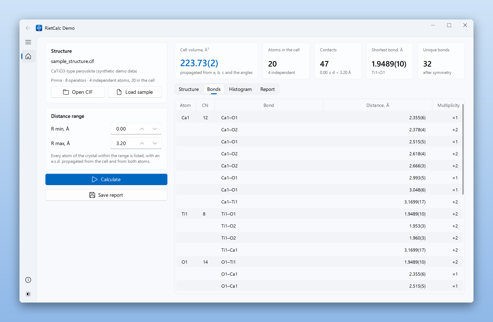
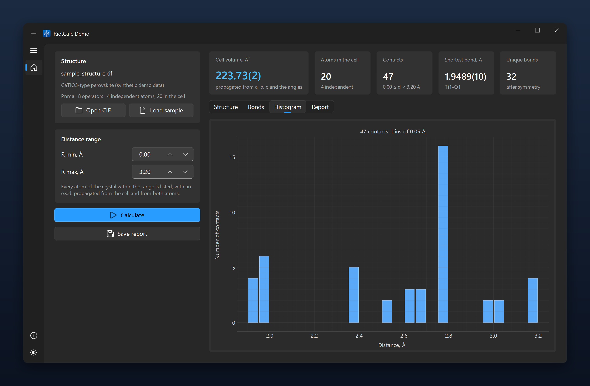
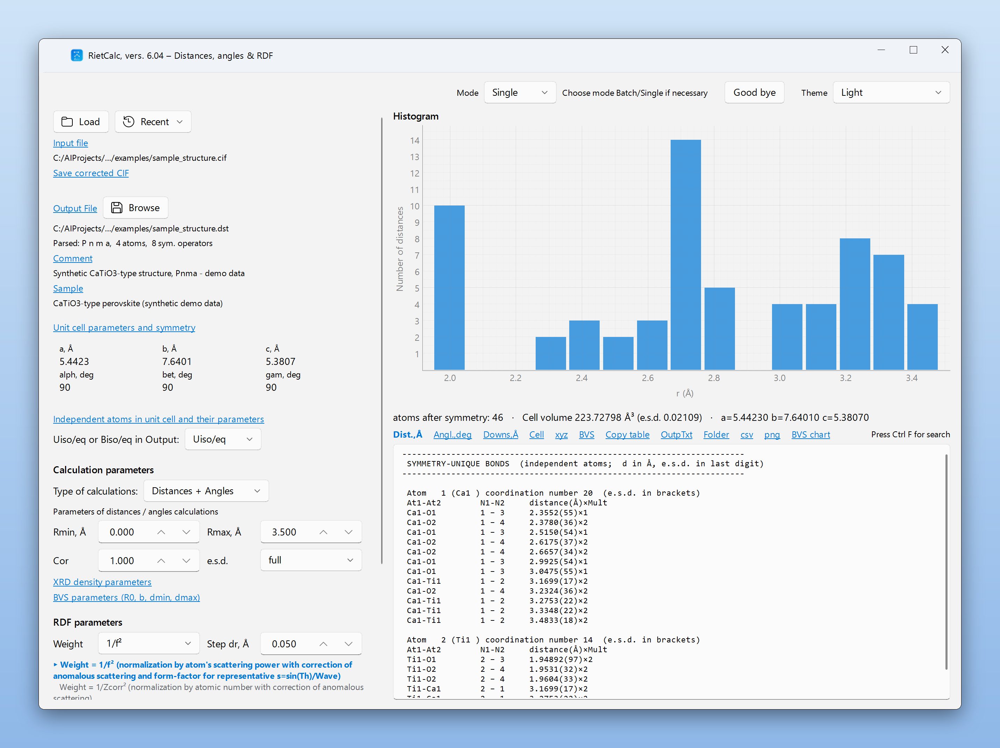
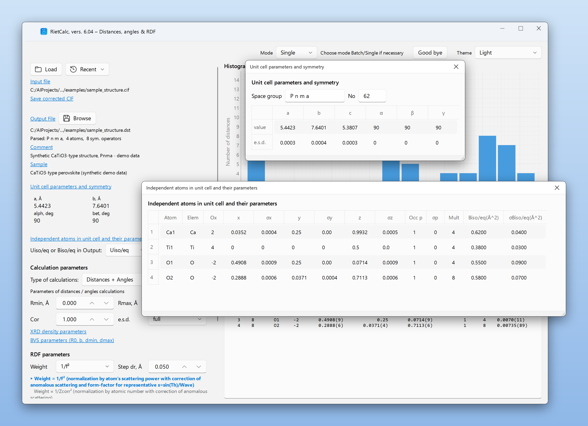
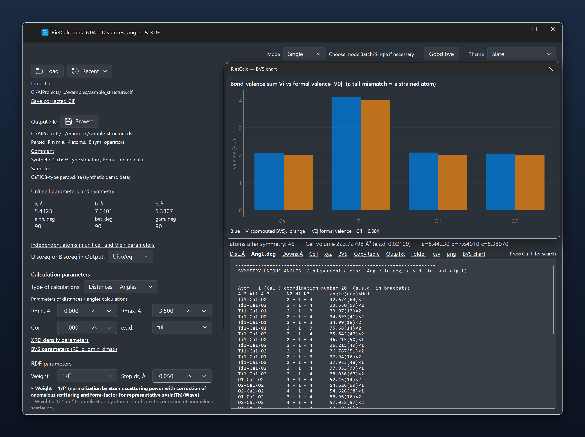
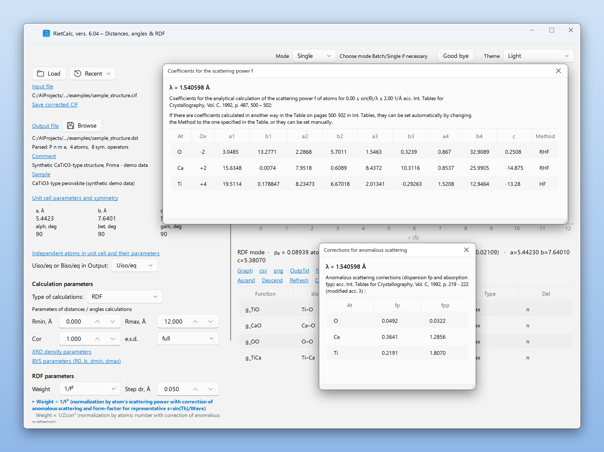
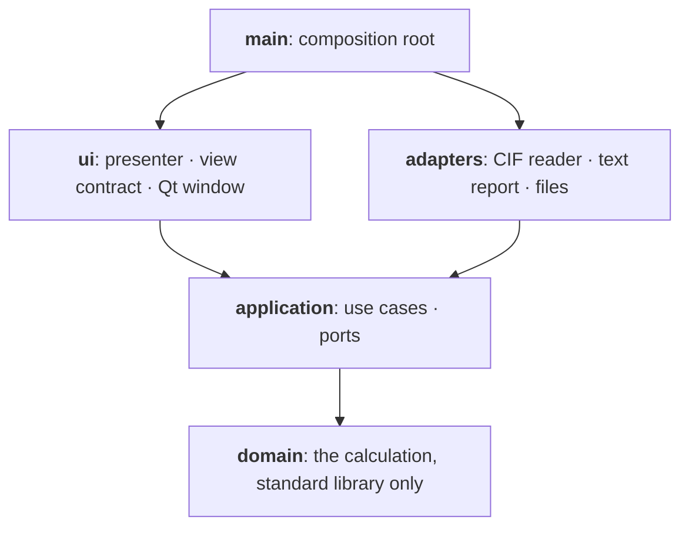

# RietCalc Demo

**How long is a bond, and how sure can you be of it?**
RietCalc Demo reads a crystal structure from a CIF file, builds the unit cell from its
symmetry, finds every interatomic distance in a chosen range and gives each one an
estimated standard deviation propagated from the uncertainties of the refinement.

[](https://github.com/bolevin/rietcalc-demo/actions/workflows/ci.yml)




RietCalc is a program by A. A. Levin with a Windows edition by
[@bolevin](https://github.com/bolevin). This repository holds a demo of it: one input format
and one calculation, written from scratch so that the crystallography and the engineering are
both easy to follow.

## What it calculates

A structure refinement, Rietveld from a powder pattern or a single-crystal one, ends with a
list: six cell parameters, and three fractional coordinates for every atom, each with its
estimated standard deviation (e.s.d.). The chemistry, though, is in the distances: the Ti-O
bond of an octahedron, the Ca-O contacts of a cage. Getting from the list to the distances
takes three steps, and each of them has a trap.

| Step | What has to happen | The trap |
|---|---|---|
| **Expand by symmetry** | Apply every operator of the space group, fold into the cell, recognise atoms on special positions | An atom on a mirror plane must be counted once, not twice |
| **Search the neighbours** | Try every atom of the crystal, in the neighbouring cells too, within *R*min ≤ *d* < *R*max | A skewed cell needs more than one neighbouring cell in each direction |
| **Propagate the errors** | *d* depends on twelve refined numbers: the cell and the coordinates of both atoms | A distance without its e.s.d. can't be compared with any other |

RietCalc Demo does all three and then groups the contacts into **symmetry-unique bonds**: for
each independent atom its coordination number, and each distinct bond with its multiplicity.
That is the table that goes into a paper.

## Run it

```powershell
git clone https://github.com/bolevin/rietcalc-demo
cd rietcalc-demo
py -3.11 -m venv .venv
.venv\Scripts\pip install -e .
.venv\Scripts\rietcalc-demo
```

Press **Load sample**, keep the range 0 to 3.2 Å and press **Calculate**. You should see:

| Cell volume | Atoms in the cell | Contacts | Shortest bond | Unique bonds |
|---|---|---|---|---|
| 223.73(2) ų | 20 | 47 | 1.9489(10) Å, Ti1-O1 | 32 |

The sample is synthetic: a CaTiO₃-type perovskite in space group *Pnma* with invented
e.s.d.'s, written by [`tools/make_sample.py`](tools/make_sample.py). No measured or unpublished
structure is in this repository. Your own structures load through **Open CIF** if the file
lists its symmetry operators, which CIFs from refinement programs do.

| The structure as read and expanded | Distance histogram, dark theme |
|---|---|
|  |  |
| **Coordination table, dark theme** | **Text report** |
|  |  |

## What the full program adds

| | Demo (this repository) | RietCalc 6.04 |
|---|:---:|:---:|
| Distances with e.s.d.'s from the cell and the coordinates | ✓ | ✓ |
| Symmetry expansion, multiplicities, special positions | ✓ | ✓ |
| Symmetry-unique bonds and coordination numbers | ✓ | ✓ |
| Distance histogram | ✓ | ✓ |
| Input: CIF | ✓ | ✓ |
| Input: the original fixed-format `.xyz` | | ✓ |
| Bond angles with e.s.d.'s | | ✓ |
| Distances corrected for thermal motion | | ✓ |
| Bond-valence sums and the global instability index, R₀/b chosen among published sets | | ✓ |
| Radial distribution function g(r) with all partials, four weightings, peak picking | | ✓ |
| Anomalous-scattering and form-factor corrections (Int. Tables C) | | ✓ |
| X-ray density with its e.s.d. | | ✓ |
| Editing the structure before a run, saving a corrected CIF | | ✓ |
| Batch mode over a folder of CIFs, summary table for Word | | ✓ |
| Themes | 2 | 7 |
| Report identical, byte for byte, to the FORTRAN original | | ✓ |

The full program on the same synthetic structure. Every number below is computed, none is
typed in:



| Bond-valence sums; the R₀/b sets published for Ti⁴⁺-O²⁻ | Radial distribution: partials, marked region, picked peaks |
|---|---|
|  |  |
| **The structure tables, editable before a run** | **Angles with e.s.d.'s and the BVS chart, dark theme** |
|  |  |



## Under the hood



The code has four layers, and every arrow points inwards. The domain is the calculation
itself: immutable values and pure functions on the standard library. The application layer
holds the use cases and declares the interfaces it needs. The adapters read CIF files and
write reports. The Qt window only shows what the presenter hands it, and the presenter is
plain Python, so every interaction, file dialogs and errors included, is tested without a
screen. Import contracts guard these boundaries and run with the tests, next to
`mypy --strict` and `ruff`.

Why it looks like this is written down in [`docs/architecture.md`](docs/architecture.md),
along arc42, with a short record for each decision in [`docs/adr/`](docs/adr/).

## Checking the numbers

| Layer | What it shows |
|---|---|
| **Golden master** | The full RietCalc program, run on the sample, gives the reference: cell content, volume and its e.s.d., and every coordination group. All 4 coordination numbers and all 32 bonds match, with the same partner and multiplicity. Distances agree to 6 × 10⁻⁷ Å, e.s.d.'s to 5 × 10⁻⁴ of their size. The two programs share no code. |
| **Hand-worked examples** | Shells of a primitive cube, a hexagonal volume, an oblique-cell distance, the e.s.d. of a product. Each one is worked out next to its assertion. |
| **Property-based tests** | For generated structures: a distance reads the same from both ends, scaling the cell scales every distance, moving the origin changes none, e.s.d.'s are positive. |
| **Mutation check** | Twenty-three deliberate mistakes are planted one at a time, and the suite has to catch every one of them. |

```powershell
.venv\Scripts\pip install -e .[dev]
.venv\Scripts\python -m pytest --cov        # 118 tests
.venv\Scripts\python -m mypy                # strict
.venv\Scripts\python -m ruff check .
.venv\Scripts\lint-imports                  # the architecture contracts
.venv\Scripts\python tools\mutation_check.py
```

These checks found real problems while the repository was being written. The first test run
caught two mistakes in the calculation. A cell with three angles of 120°, which encloses no
volume, was accepted because rounding left it 10⁻⁸ ų. And `0.1(4`, with its bracket missing,
was read as a number. The first mutation run found two tests that could not fail: nothing told
equal distances to *different* atoms apart from one bond, and nothing pinned a value lying
exactly on a histogram bin edge. Each of them has its test now.

One thing a demo can't show. RietCalc 6.04 reproduces the report of its FORTRAN original
**byte for byte** on reference data sets: every symmetry-expanded position, every distance,
every angle, some 20,000 numbers, checked on every build. Those reference files are real
refinements and not ours to publish, so here the full program itself is the reference.

## The story behind it

RietCalc started as a FORTRAN program by A. A. Levin, built in part on symmetry and geometry
routines from the 1980s. I led its move to Windows in thirty steps, up to version 6.04. The
first goal was a faithful port: the Python core follows the FORTRAN routines statement by
statement and emulates single precision where it matters, until its report matched the
original's. Only then came the new features: radial distribution, bond-valence sums, X-ray
density and batch mode.

Every step started from a written specification by the scientist and ended with regression
guards that stay in the suite, about 250 of them by version 6.04. I planned the steps, set the
acceptance rules, judged screen changes on rendered images of the real window, and trusted a
new check only after I had seen it fail on broken code. The code came from an AI coding agent
(Claude Code). I gave it the tasks and the rules and decided when a step was done.

This demo was written later, from scratch, to show the same calculation in a code base that is
organised for reading.

## Repository layout

```
src/rietcalc_demo/
    domain/         the calculation
    application/    use cases and ports
    adapters/       CIF reader, text report, file store
    ui/             presenter, view contract, Qt window, histogram
    data/           synthetic sample structure, icon
    main.py         composition root, command line
tests/              mirrors the package; golden/ holds the reference values
tools/              sample, icon, reference values, screenshots, mutation check
docs/               architecture.md (arc42), adr/, img/
packaging/          PyInstaller spec for the one-file executable
```

## Building the executable

```powershell
.venv\Scripts\pip install -e .[build]
.venv\Scripts\pyinstaller packaging\rietcalc-demo.spec
dist\rietcalc-demo.exe --selftest
```

The executable is not code-signed, so Windows SmartScreen shows a warning the first time it
is started ("More info", then "Run anyway").

## Citing

If the demo helped your work, please cite it via [`CITATION.cff`](CITATION.cff). The methods
it implements are textbook crystallography. The conventions it follows are named where they
are used: the error model in [ADR 0004](docs/adr/0004-error-model-of-the-full-program.md), the
way e.s.d.'s are written in [ADR 0005](docs/adr/0005-esds-written-by-the-rule-of-19.md).

## Authors and licence

A. A. Levin: the original program and the scientific direction.
[@bolevin](https://github.com/bolevin): the Windows edition and this demo.

Free software under the **GNU General Public License, version 3 or later**, see
[`LICENSE`](LICENSE). The interface uses QFluentWidgets, which is GPL-3.0 too, and
[`THIRD-PARTY-NOTICES.md`](THIRD-PARTY-NOTICES.md) lists every component. The full RietCalc
program is not part of this repository and is not covered by this licence.
