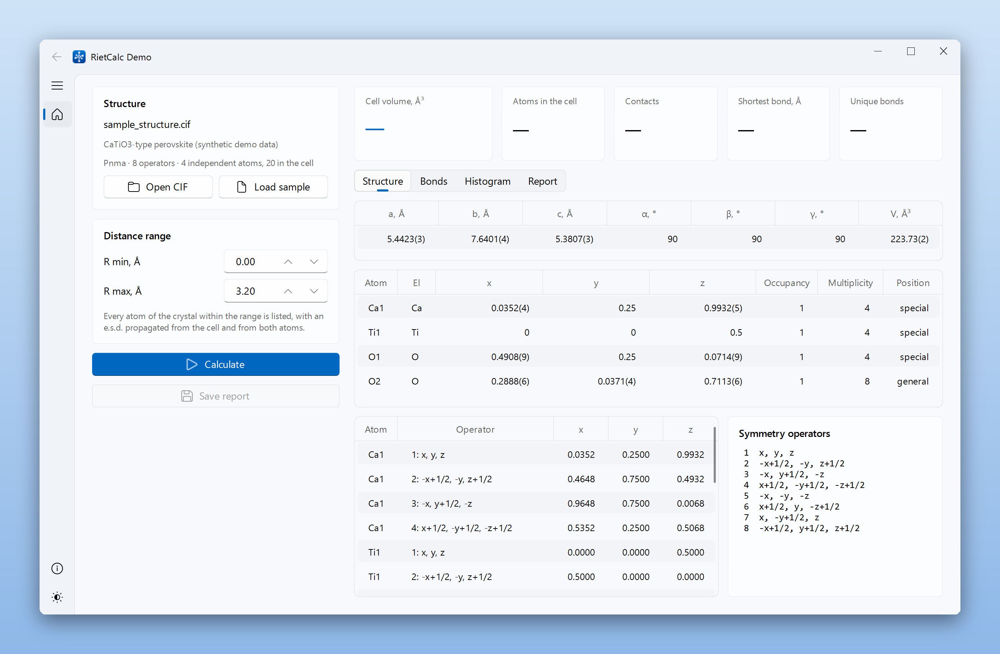
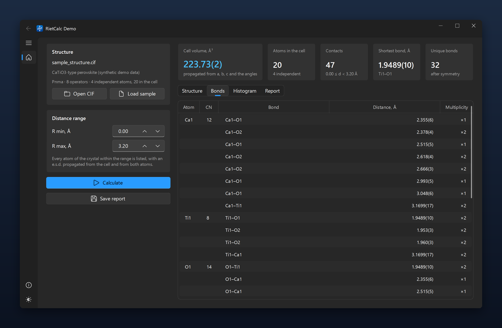
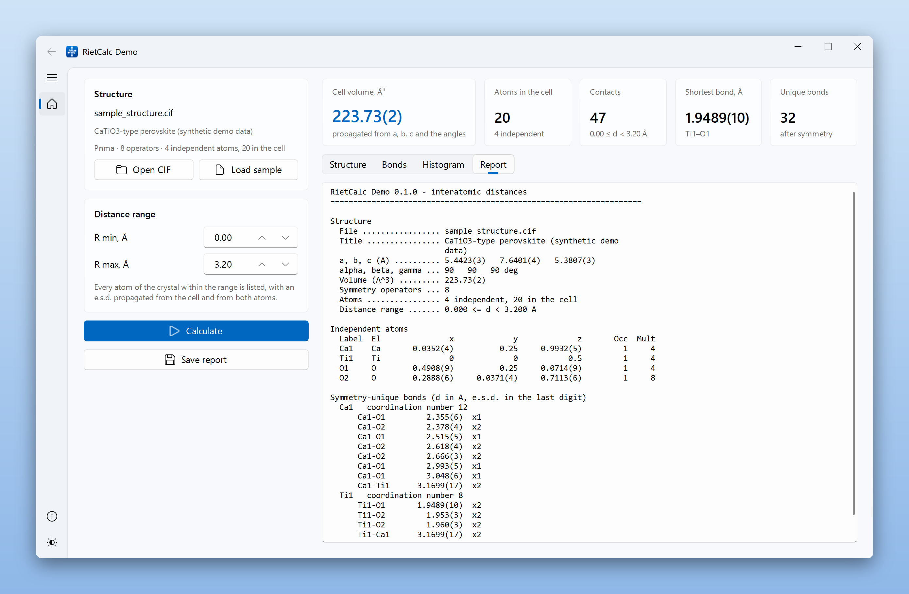
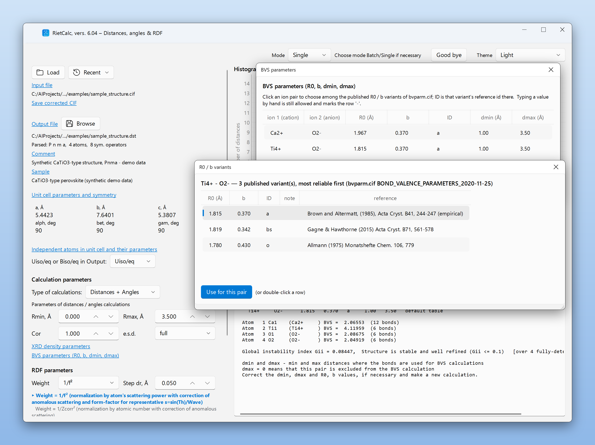
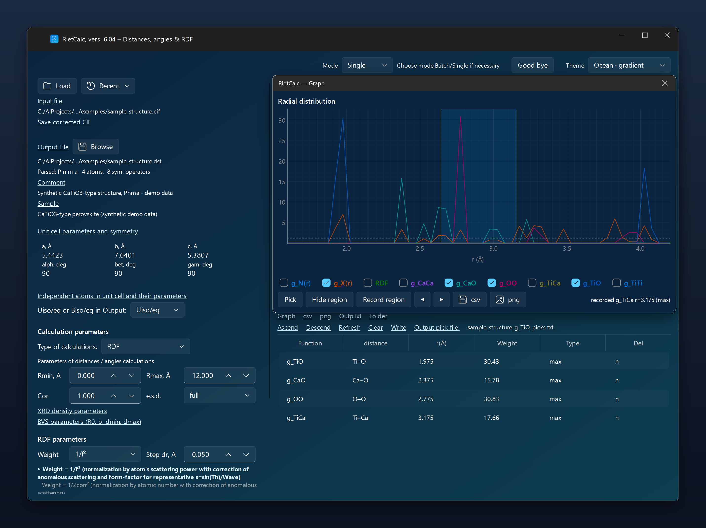
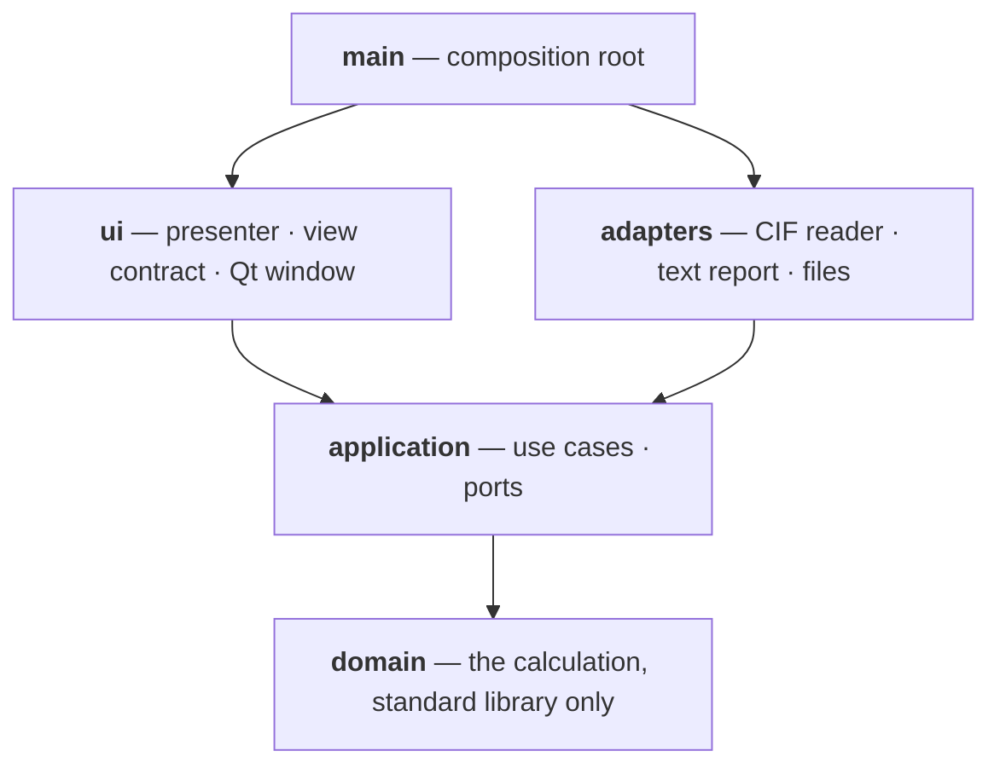

# RietCalc Demo

**How long is a bond, and how sure can you be of it?**
RietCalc Demo reads a crystal structure from a CIF file, builds the unit cell from its
symmetry, finds every interatomic distance in a chosen range and gives each one an
estimated standard deviation propagated from the uncertainties of the refinement.

[](https://github.com/bolevin/rietcalc-demo/actions/workflows/ci.yml)


This is a demonstration version of **RietCalc**, a program by Aleksandr A. Levin and
Boris A. Levin. It is small on purpose — one input format, one calculation — and is meant
to show two things: what the calculation does, and how the software around it is built.

## The problem it solves

A structure refinement — Rietveld from a powder pattern, or a single-crystal refinement —
ends with a list: six cell parameters, and for every atom three fractional coordinates,
each with its estimated standard deviation (e.s.d.). The chemistry, however, is in the
distances: the Ti–O bond of an octahedron, the Ca–O contacts of a cage. Getting from the
list to the distances takes three steps, and each has a trap:

| Step | What has to happen | The trap |
|---|---|---|
| **Expand by symmetry** | Apply every operator of the space group, fold into the cell, recognise atoms on special positions | An atom on a mirror plane must be counted once, not twice |
| **Search the neighbours** | Try every atom of the crystal, in neighbouring cells as well, within *R*min ≤ *d* < *R*max | Skew cells need more neighbouring cells than one in each direction |
| **Propagate the errors** | *d* depends on twelve refined numbers — the cell and both atoms' coordinates | A distance printed without its e.s.d. cannot be compared with any other |

RietCalc Demo does all three and then groups the contacts into **symmetry-unique bonds**:
for each independent atom, its coordination number and each distinct bond with its
multiplicity — the table that goes into a paper.

## Try it

```powershell
git clone https://github.com/bolevin/rietcalc-demo
cd rietcalc-demo
py -3.11 -m venv .venv
.venv\Scripts\pip install -e .
.venv\Scripts\rietcalc-demo
```

Press **Load sample**, keep the range 0–3.2 Å, press **Calculate**. You should see:

| Cell volume | Atoms in the cell | Contacts | Shortest bond | Unique bonds |
|---|---|---|---|---|
| 223.73(2) ų | 20 | 47 | 1.9489(10) Å, Ti1–O1 | 32 |

The sample is synthetic — a CaTiO₃-type perovskite in space group *Pnma* with invented
e.s.d.'s, written by [`tools/make_sample.py`](tools/make_sample.py). No measured or
unpublished structure is part of this repository. Your own structures load through
**Open CIF** if the file lists its symmetry operators, as CIFs from refinement programs do.

| The structure as read and expanded | Distance histogram, dark theme |
|---|---|
|  |  |
| **Coordination table, dark theme** | **Text report** |
|  |  |

## Demo and full program

| | Demo (this repository) | RietCalc 6.04 |
|---|:---:|:---:|
| Distances with e.s.d.'s from the cell and the coordinates | ✓ | ✓ |
| Symmetry expansion, multiplicities, special positions | ✓ | ✓ |
| Symmetry-unique bonds and coordination numbers | ✓ | ✓ |
| Distance histogram | ✓ | ✓ |
| Input: CIF | ✓ | ✓ |
| Input: the original fixed-format `.xyz` | | ✓ |
| Bond angles with e.s.d.'s | | ✓ |
| Distances corrected for thermal motion (Downs et al.) | | ✓ |
| Bond-valence sums and the global instability index, R₀/b chosen among published sets | | ✓ |
| Radial distribution function g(r) with all partials, four weightings, peak picking | | ✓ |
| Anomalous-scattering and form-factor corrections (Int. Tables C) | | ✓ |
| X-ray density with its e.s.d. | | ✓ |
| Editing the structure before a run, saving a corrected CIF | | ✓ |
| Batch mode over a folder of CIFs, summary table for Word | | ✓ |
| Themes | 2 | 7 |
| Report identical, byte for byte, to the FORTRAN original | | ✓ |

The full program on the same synthetic structure — every number below is computed, not
typed in:


| Bond-valence sums; the R₀/b sets published for Ti⁴⁺–O²⁻ | Radial distribution: partials, marked region, picked peaks |
|---|---|
|  |  |
| **The structure tables, editable before a run** | **Angles with e.s.d.'s and the BVS chart, dark theme** |
|  |  |


## How it is built



- **Ports and adapters.** The calculation is a set of pure functions over immutable values.
  It reads no file and knows no window. Use cases declare what they need as interfaces;
  files and Qt implement them at the edge.
- **Model–View–Presenter with a passive view.** The presenter is plain Python and decides
  everything; the window only shows what it is handed. The whole interaction — including
  file dialogs and every error path — is tested without a display.
- **Architecture rules are tests.** "The calculation imports nothing but the standard
  library" and "the presenter never touches Qt" are import contracts checked on every run.
- **Typed and linted.** `mypy --strict`, `ruff` with a broad rule set, one formatting style.

The reasoning is written down: [`docs/architecture.md`](docs/architecture.md) follows the
arc42 template, and each decision has its own record in [`docs/adr/`](docs/adr/).

## How the numbers are checked

| Layer | What it shows |
|---|---|
| **Golden master** | The full RietCalc program, run on the sample, is the reference: cell content, volume and its e.s.d., and every coordination group — 4 of 4 coordination numbers, 32 of 32 bonds with the same partner and multiplicity. Distances agree to 6 × 10⁻⁷ Å, e.s.d.'s to 5 × 10⁻⁴ of their size. The two programs share no code. |
| **Hand-worked examples** | Shells of a primitive cube, a hexagonal volume, an oblique-cell distance, the e.s.d. of a product — each worked out beside its assertion. |
| **Property-based tests** | For generated structures: a distance reads the same from both ends, scaling the cell scales every distance, moving the origin changes none, e.s.d.'s are positive. |
| **Mutation check** | Twenty-three deliberate mistakes are planted one at a time; each must turn the suite red. A test that cannot fail is worse than no test. |

```powershell
.venv\Scripts\pip install -e .[dev]
.venv\Scripts\python -m pytest --cov        # 118 tests
.venv\Scripts\python -m mypy                # strict
.venv\Scripts\python -m ruff check .
.venv\Scripts\lint-imports                  # the architecture contracts
.venv\Scripts\python tools\mutation_check.py
```

The checks earned their place while this repository was being written. The first run of
the tests found two mistakes in the calculation itself: a cell with three angles of 120°
— which closes no volume — was accepted, because rounding left it 10⁻⁸ ų; and
`0.1(4`, with its bracket missing, was read as a number. The first run of the mutation
check found two tests that could not fail: nothing told equal distances to *different*
atoms apart from one bond, and nothing pinned a value lying exactly on a histogram bin
edge. Each now has its test.

One thing this demo cannot show is the full program's strongest guarantee. RietCalc 6.04
reproduces the report of its FORTRAN original **byte for byte** on reference data sets —
every symmetry-expanded position, every distance, every angle, some 20,000 numbers — and
checks this on every build. Those reference files are real refinements and are not ours
to publish, so here the full program itself serves as the reference.

## Where it comes from

RietCalc began as a FORTRAN program by Aleksandr A. Levin, built in part on symmetry
and geometry routines from the 1980s. The Windows edition was developed from the FORTRAN
source in thirty specification-driven steps:

- **A faithful port first.** The Python core follows the FORTRAN routines statement by
  statement and emulates single precision where it matters, until the report is identical
  to the original's. Only then did features follow: RDF, bond-valence sums, X-ray
  density, batch mode.
- **Specifications from the scientist.** Each step started from a written specification by
  the author of the original and ended with regression guards that stay in the suite —
  about 250 of them by version 6.04.
- **Pixels, not properties.** Visual changes were accepted on rendered images of the real
  window — a headless test reads a label's text and never sees that it is clipped.
- **Tests of the tests.** New assertions had to be shown failing on broken code before
  they counted.
- **Human direction, machine labour.** Requirements, physics and acceptance came from the
  authors; implementation was done with an AI coding agent (Claude Code) working under
  those rules.

The demo was then written from scratch — not cut down from the full program — to show the
same calculation in a code base organised for reading.

## Repository layout

```
src/rietcalc_demo/
    domain/         the calculation
    application/    use cases and ports
    adapters/       CIF reader, text report, file store
    ui/             presenter, view contract, Qt window, histogram
    data/           synthetic sample structure, icon
    main.py         composition root, command line
tests/              mirrors the package; golden/ holds the reference values
tools/              sample, icon, reference values, screenshots, mutation check
docs/               architecture.md (arc42), adr/, img/
packaging/          PyInstaller spec for the one-file executable
```

## Building the executable

```powershell
.venv\Scripts\pip install -e .[build]
.venv\Scripts\pyinstaller packaging\rietcalc-demo.spec
dist\rietcalc-demo.exe --selftest
```

The executable is not code-signed, so Windows SmartScreen shows a warning the first time it
is started ("More info" → "Run anyway").

## Citing

If the demo contributed to your work, please cite it via
[`CITATION.cff`](CITATION.cff). The methods it implements are textbook crystallography;
the conventions it follows are named where they are used — the error model in
[ADR 0004](docs/adr/0004-error-model-of-the-full-program.md), the way e.s.d.'s are written
in [ADR 0005](docs/adr/0005-esds-written-by-the-rule-of-19.md).

## Authors and licence

Aleksandr A. Levin — original program, scientific direction. Boris A. Levin — Windows
edition, this demo.

Free software under the **GNU General Public License, version 3 or later**; see
[`LICENSE`](LICENSE). The interface is built on QFluentWidgets, which is itself GPL-3.0 —
[`THIRD-PARTY-NOTICES.md`](THIRD-PARTY-NOTICES.md) lists every component. The full
RietCalc program is not part of this repository and is not covered by this licence.
