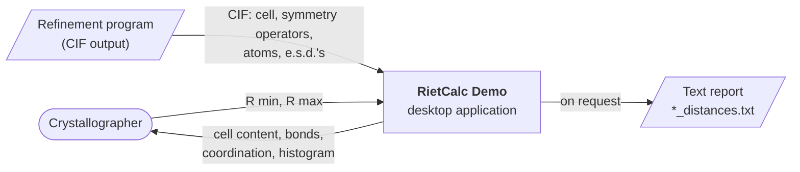
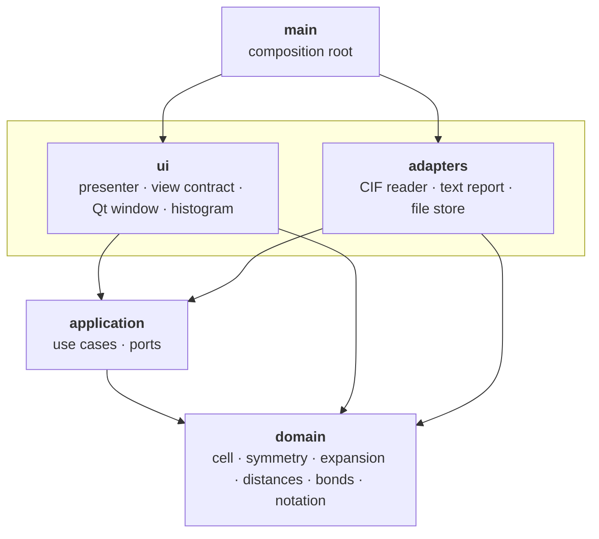
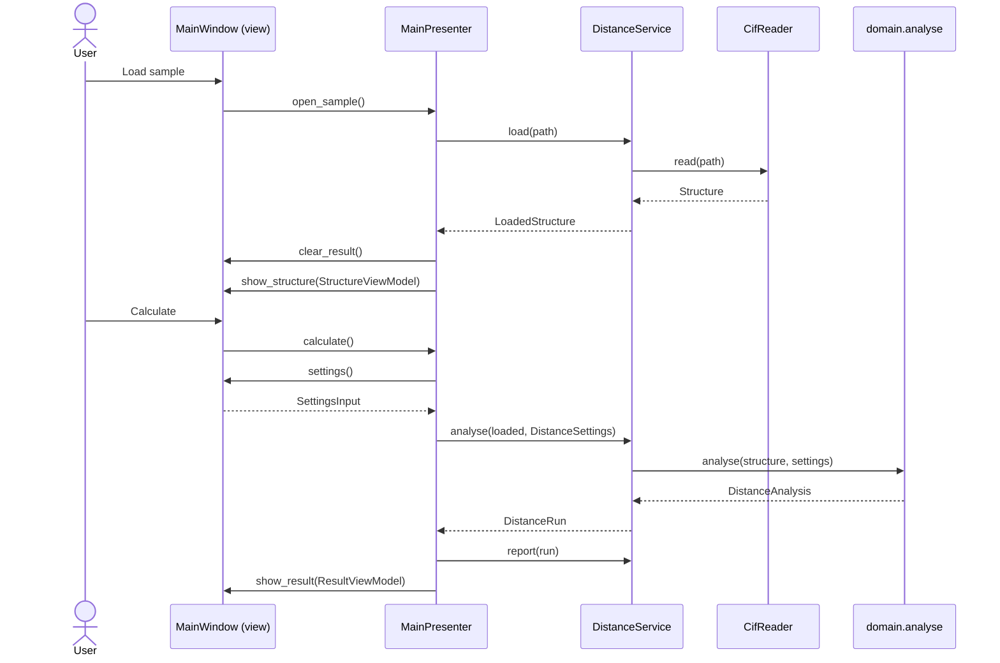
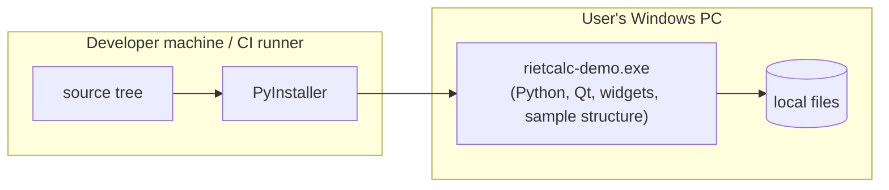

# RietCalc Demo — architecture (arc42)

This document follows the [arc42](https://arc42.org) template, all twelve sections, kept lean.
Decisions are recorded one per file in [`adr/`](adr/). Where a rule or a quality goal is
enforced by a test, the test is named — a statement here that no test holds is marked as such.

| | |
|---|---|
| Version described | 0.1.1 |
| Audience | developers, reviewers, anyone judging how the program is built |

---

## 1. Introduction and goals

### 1.1 What the program does

A structure refinement ends with the unit cell and, for every independent atom, three
fractional coordinates — each number with its estimated standard deviation (e.s.d.). The
chemistry lies in the interatomic distances, which the refinement does not print.

RietCalc Demo reads a structure from a CIF file and reports

- the **unit cell content**: every atom the space-group operators generate, folded into the
  cell, with atoms on special positions recognised and counted once;
- every **interatomic distance** with *R*min ≤ *d* < *R*max, with its **e.s.d.** propagated
  from the six cell parameters and the six coordinates involved;
- the **coordination** of each independent atom: its symmetry-unique bonds, each with its
  multiplicity, and the coordination number;
- the **cell volume** with its e.s.d. and a **histogram** of the distances.

It is a demonstration version of the RietCalc program by A. A. Levin, with a
Windows edition by bolevin. The full program is a separate code base; the demo shares no code with it
and is checked against it (section 8.1).

### 1.2 Quality goals, in priority order

| # | Goal | What it means here |
|---|---|---|
| 1 | **Correct numbers** | Every distance, e.s.d., multiplicity and coordination number agrees with the full program to the precision that program works in. |
| 2 | **Changeable without fear** | A new input format, report layout or error convention touches one module; the calculation is never edited to serve the window. |
| 3 | **Testable without a screen** | Everything except the pixels is exercised by tests that need no display and no file dialog. |
| 4 | **Honest failure** | A malformed file or an impossible setting produces a message that names the cause; no stale result stays on screen. |

Section 10 turns each goal into scenarios and names the tests that hold them.

### 1.3 Stakeholders

| Who | What they need from this document |
|---|---|
| Crystallographer using the program | Confidence in the numbers: sections 1.1, 8.1, 11 |
| Developer extending it | Where things go and which rules are enforced: sections 5, 8, 9 |
| Reviewer of the code base | The decisions and their reasons: sections 4, 9, `adr/` |

## 2. Constraints

| Constraint | Consequence |
|---|---|
| Windows 10/11 desktop, no installer | One-file `.exe` built with PyInstaller; no services, no registry use |
| Python ≥ 3.11 | `slots` dataclasses, `X | None` types, `fractions.Fraction` for exact translations |
| GUI toolkit is PySide6 with QFluentWidgets | QFluentWidgets is GPL-3.0, so the program is GPL-3.0-or-later ([ADR 0003](adr/0003-fluent-widgets-and-gpl.md)) |
| Only synthetic data may ship | The bundled structure is written by `tools/make_sample.py` ([ADR 0006](adr/0006-synthetic-sample-data.md)) |
| Results must match the reference program | The demo keeps the full program's error model, simplifications included ([ADR 0004](adr/0004-error-model-of-the-full-program.md)) |

## 3. Context and scope

**Business context.** One actor, one input, one optional output. The user refines a
structure elsewhere, writes it out as a CIF, and chooses the range of distances to list.

**Technical context.** The only interfaces are the local file system (a CIF in, a UTF-8
text file out) and the screen. There is no network access, no database and no persisted
setting.

**Out of scope.** Angles, distances corrected for thermal motion, bond-valence sums,
radial distribution functions, X-ray density, editing the structure, batch processing and
the original `.xyz` input format belong to the full program.

## 4. Solution strategy

| Goal | Approach |
|---|---|
| Correct numbers | A pure calculation with no I/O, pinned by a golden-master test against the full program, hand-worked examples and property-based tests ([ADR 0004](adr/0004-error-model-of-the-full-program.md)) |
| Changeable | Ports and adapters: the calculation and the use cases define interfaces; files and windows implement them ([ADR 0001](adr/0001-ports-and-adapters.md)) |
| Testable without a screen | Model–View–Presenter with a passive view: the presenter is plain Python and is tested against a fake view ([ADR 0002](adr/0002-mvp-passive-view.md)) |
| Rules that stay true | The dependency rule is a test, not a convention ([ADR 0007](adr/0007-architecture-rules-as-tests.md)) |
| Trustworthy tests | Every guard is shown to fail on deliberately broken code (`tools/mutation_check.py`) |

## 5. Building block view

### 5.1 Level 1

| Block | Responsibility | Depends on |
|---|---|---|
| `domain` | The calculation: immutable values and pure functions | standard library only |
| `application` | The use cases (load, analyse, report, export) and the ports they need | `domain` |
| `adapters` | The ports implemented with files and text | `application`, `domain` |
| `ui` | Presenter, view contract, the Qt window | `application`, `domain` |
| `main` | Builds the concrete objects and wires them; `--selftest` | everything |

### 5.2 Level 2: `domain`

| Module | Contents |
|---|---|
| `measured` | `Measured(value, esd)`: a number and its e.s.d., the currency of the whole calculation |
| `propagation` | `propagate(f, values, esds)`: first-order propagation of independent errors by central differences |
| `cell` | `metric_distance` — the one formula of the geometry; `UnitCell` with its volume, its e.s.d. and the reciprocal lengths that bound the neighbour search |
| `symmetry` | `SymmetryOperator`: parsed from `-x+1/2, -y, z+1/2` with exact fractions; applied to a position and to its e.s.d.'s |
| `structure` | `Atom`, `Structure`: valid by construction — unique labels, occupancies in [0, 1], the identity among the operators |
| `expansion` | `orbit`, `expand`, `multiplicities`: the atoms of one unit cell, special positions counted once |
| `distances` | `contacts(structure, r_min, r_max)`: every pair in range, lattice repeats included, each with its e.s.d. |
| `bonds` | `coordination`: contacts grouped into symmetry-unique bonds per independent atom |
| `notation` | `format_measured` / `parse_measured`: `1.9489(10)` by the rule of 19 ([ADR 0005](adr/0005-esds-written-by-the-rule-of-19.md)) |
| `histogram` | `histogram(values, width)`: contiguous bins `[low, high)` |
| `analysis` | `DistanceSettings`, `DistanceAnalysis`, and `analyse(structure, settings)` — the whole calculation as one function |
| `errors` | `DomainError` → `InvalidStructureError`, `InvalidSettingsError` |

### 5.3 Level 2: `ui`

| Module | Contents | Imports Qt |
|---|---|---|
| `view` | `MainView` (a `Protocol`) and the view models: text already formatted, plain tuples of numbers | no |
| `presenter` | `MainPresenter`: turns intents into use-case calls and results into view models; owns the error messages | no |
| `main_window` | `MainWindow`: the one implementation of `MainView`; shows what it is given, forwards clicks | yes |
| `plot` | `HistogramPanel`: the distance histogram; re-colours itself on a theme switch | yes |

### 5.4 Dependency rules

Three contracts in `pyproject.toml` (`[tool.importlinter]`), run by
`tests/architecture/test_layers.py` and as a CI step of their own:

1. **Dependencies point inwards**: `main` → `ui` | `adapters` → `application` → `domain`;
   `ui` and `adapters` do not know each other.
2. **The calculation depends on the standard library only**: `domain` and `application`
   may not import PySide6, QFluentWidgets, pyqtgraph or numpy.
3. **The presenter is free of Qt**: `ui.presenter` and `ui.view` may not import PySide6,
   QFluentWidgets or pyqtgraph.

## 6. Runtime view

### 6.1 Load a structure and calculate

### 6.2 When something is wrong

Errors are values of three known kinds — `OSError` (the file system),
`StructureFormatError` (the file is not a readable CIF), `DomainError` (the structure or
the settings cannot be analysed). Each carries a sentence written for the user. The
presenter catches exactly these, calls `clear_result()` so that no number from an earlier
run stays visible, and shows the message. A file that fails to load leaves the previously
loaded structure in place.

### 6.3 Inside `analyse`

1. Expand: apply every operator to every independent atom, fold into [0, 1), drop images
   that land on a site already taken (within 10⁻⁴ in fractional coordinates, up to a
   lattice translation) — that is what makes an atom on a mirror plane count once.
2. Bound the search: a neighbour can be closer than *R* only if its fractional difference
   along each axis is at most *R*·*a*\*, *R*·*b*\*, *R*·*c*\*; this fixes the lattice
   translations to try, also in skew cells.
3. For each independent atom and each image and translation in reach, compute *d* with the
   metric of the cell; keep *R*min ≤ *d* < *R*max.
4. For each kept contact, propagate the e.s.d. from twelve independent parameters: the six
   cell parameters, the source's three coordinates and the neighbour's three
   ([ADR 0004](adr/0004-error-model-of-the-full-program.md)).
5. Group the contacts of each independent atom: the same partner within 10⁻³ Å is one
   bond with a multiplicity.

No step reads or writes anything; the same input always gives the same output.

## 7. Deployment view

Two ways to run it: from source (`pip install -e .` then `rietcalc-demo`), or as a single
executable built from `packaging/rietcalc-demo.spec`. The executable carries the
interpreter, Qt, the widget library and the sample structure; it needs no installation and
writes nothing except the reports the user saves. `rietcalc-demo --selftest` verifies a
build without opening a window. The release workflow builds the executable when a version
tag is pushed.

## 8. Crosscutting concepts

### 8.1 Verification of the numbers

| Layer | What it shows | Where |
|---|---|---|
| Golden master | Cell content, volume and its e.s.d., and every coordination group of the bundled structure equal those of the full RietCalc program: same partners, same multiplicities, distances within 2 × 10⁻⁶ Å, e.s.d.'s within 10⁻³ of their size (measured: 6 × 10⁻⁷ Å and 4.6 × 10⁻⁴) | `tests/domain/test_golden.py`, recorded by `tools/make_golden.py` |
| Hand-worked examples | Shells of a primitive cube; volumes and distances in orthorhombic and hexagonal cells; propagation through a sum and a product | `tests/domain/test_cell.py`, `test_distances_and_bonds.py`, `test_propagation.py` |
| Properties | For generated structures: *d*(A, B) = *d*(B, A); scaling the cell by *k* scales every distance by *k*; moving the origin changes no distance; every e.s.d. is positive; the notation keeps 2–19 units in the last place | `tests/domain/test_properties.py` |
| Mutation check | Twenty-three deliberate mistakes; each must turn the suite red | `tools/mutation_check.py` |

The golden master is independent evidence: the two programs share no code — the full
program is a port of the FORTRAN original and works in single precision, the demo is new
and works in double — and the reference values are committed as JSON, so the test needs
nothing but this repository.

### 8.2 Errors

Exceptions are raised where the fact is known and caught in one place, the presenter. The
message is composed at the point of failure ("Line 14: the _atom_site_label table has
3 values for 4 columns."), never
reconstructed later. Programming errors are not caught.

### 8.3 Numbers in and out

Input fields use the C locale: a point is the decimal separator whatever Windows is set to
(`tests/ui/test_main_window.py`, with a German system locale). Measured numbers are read
and written in the crystallographic `value(esd)` notation by one pair of functions in
`domain.notation`, so the CIF reader and the report cannot disagree. Reports are plain
text with CRLF line ends. Internally everything is `float`; symmetry translations are
exact fractions until they are applied.

### 8.4 Presentation

View models carry finished strings. Formatting therefore lives in the presenter and the
report adapter and is tested there; the window has no number formatting of its own.
Theming: the widget library follows a light or dark theme; the histogram keeps its own two
palettes and rebuilds its bars on a switch, because the plotting library fixes colours
when an item is created.

### 8.5 Testing

Tests mirror the package layout. The presenter is tested against a `FakeView` that records
calls and answers dialogs from a script; the Qt window is driven through its widgets on the
offscreen platform. Visual checks are done on rendered images (`tools/make_screenshots.py`),
because an offscreen test cannot see a wrong colour or a clipped label.

## 9. Architecture decisions

| ADR | Decision |
|---|---|
| [0001](adr/0001-ports-and-adapters.md) | Ports and adapters around a pure domain |
| [0002](adr/0002-mvp-passive-view.md) | Model–View–Presenter with a passive view |
| [0003](adr/0003-fluent-widgets-and-gpl.md) | QFluentWidgets for the interface; GPL-3.0-or-later as a consequence |
| [0004](adr/0004-error-model-of-the-full-program.md) | The error model of the full program, in double precision, verified by a golden master |
| [0005](adr/0005-esds-written-by-the-rule-of-19.md) | e.s.d.'s written by the rule of 19 |
| [0006](adr/0006-synthetic-sample-data.md) | Ship synthetic sample data only |
| [0007](adr/0007-architecture-rules-as-tests.md) | Architecture rules are tests |

## 10. Quality requirements

Each scenario is held by the test named beside it.

| Goal | Scenario | Held by |
|---|---|---|
| Correct numbers | The bundled structure, 0–3.2 Å, gives the cell content, volume and coordination table of the full program | `test_golden.py::test_cell_content_and_volume`, `::test_coordination_matches_the_full_program` |
| Correct numbers | The reference values belong to the structure that ships | `test_golden.py::test_reference_belongs_to_the_bundled_structure` |
| Correct numbers | An atom on a special position is counted once; its fixed coordinate carries no e.s.d. | `test_structure_and_expansion.py::test_sample_multiplicities_follow_the_site_symmetry`, `::test_an_atom_on_a_mirror_keeps_its_y` |
| Correct numbers | Equal distances to different atoms remain different bonds | `test_distances_and_bonds.py::test_equal_distances_to_different_atoms_stay_separate_bonds` |
| Changeable | A use case runs with every port replaced by an in-memory fake | `tests/application/test_service.py` |
| Changeable | A module of the calculation that imports numpy or Qt fails the build | `tests/architecture/test_layers.py` |
| Testable without a screen | The complete load–calculate–save flow, including dialogs, runs without Qt | `tests/ui/test_presenter.py` |
| Honest failure | Five kinds of malformed CIF each give a message naming the cause | `test_cif.py::test_format_errors_name_the_problem` |
| Honest failure | A cell whose angles close no volume is refused, not computed with | `test_cell.py::test_impossible_cells_are_refused` |
| Honest failure | After a failed calculation, or when another file is opened, no earlier result is shown | `test_presenter.py::test_bad_range_reports_an_error_and_clears`, `test_main_window.py::test_a_new_file_clears_the_old_result` |

## 11. Risks and technical debt

| Item | Status |
|---|---|
| **Simplified error model.** Like the full program, the demo treats the twelve parameters of a distance as independent, even when the neighbour is an image of the source atom itself, and carries coordinate e.s.d.'s through an operator as \|*R*·σ\| row by row. Exact for the operators of orthorhombic and higher symmetry; for rows such as `x-y` it differs from √(σx² + σy²). | Kept deliberately so that the two programs agree ([ADR 0004](adr/0004-error-model-of-the-full-program.md)); the golden master covers an orthorhombic structure only. |
| **One reference structure.** The golden master covers one structure in one range. Skew cells are covered by hand-worked tests and properties only. | Accepted for a demo. |
| **CIF subset.** The reader needs the symmetry operators listed in the file; a space-group symbol alone is refused with a message. Of several data blocks, the first one with an atom table is read. | Accepted; a symbol-to-operators table would be one more adapter-side module. |
| **Range limit.** *R*max is limited to 8 Å; the e.s.d. of each contact costs 24 evaluations of the distance. | Deliberate; long ranges are what the full program's RDF is for. |
| **Untyped GUI libraries.** QFluentWidgets and pyqtgraph ship no type information; mypy treats them as `Any`. | Confined to `ui.main_window` and `ui.plot`. |
| **Unsigned executable.** Windows SmartScreen warns on first start. | Stated in the README. |
| **Tested on Windows only.** Nothing is known to be Windows-specific except the packaging, but no other platform is in CI. | Open. |

## 12. Glossary

| Term | Meaning |
|---|---|
| CIF | Crystallographic Information File, the standard text format for crystal structures |
| Unit cell | The parallelepiped that repeats to build the crystal; edges *a*, *b*, *c*, angles α, β, γ |
| Fractional coordinates | Position of an atom in units of the cell edges, 0 ≤ *x*, *y*, *z* < 1 |
| Space group, operator | The symmetry of the crystal; each operator maps a position to an equivalent one, e.g. `-x+1/2, -y, z+1/2` |
| Independent atom | An atom listed in the CIF; the operators generate the others |
| Special position | A site that some operators map onto itself, e.g. on a mirror plane; its atom appears fewer times in the cell |
| Multiplicity | Number of atoms an independent atom generates in the cell; for a bond, how many times it occurs around the atom |
| Coordination number | Number of neighbours of an atom within the range |
| Symmetry-unique bond | One entry per distinct partner and distance; its multiplicity counts the equivalent copies |
| e.s.d. | Estimated standard deviation, written `1.9489(10)`: 1.9489 ± 0.0010 |
| Rule of 19 | Journal convention: two digits of e.s.d. when they form 10–19, otherwise one |
| Port | An interface the application defines and an adapter implements |
| Golden master | A test that compares against recorded output of a trusted implementation |
